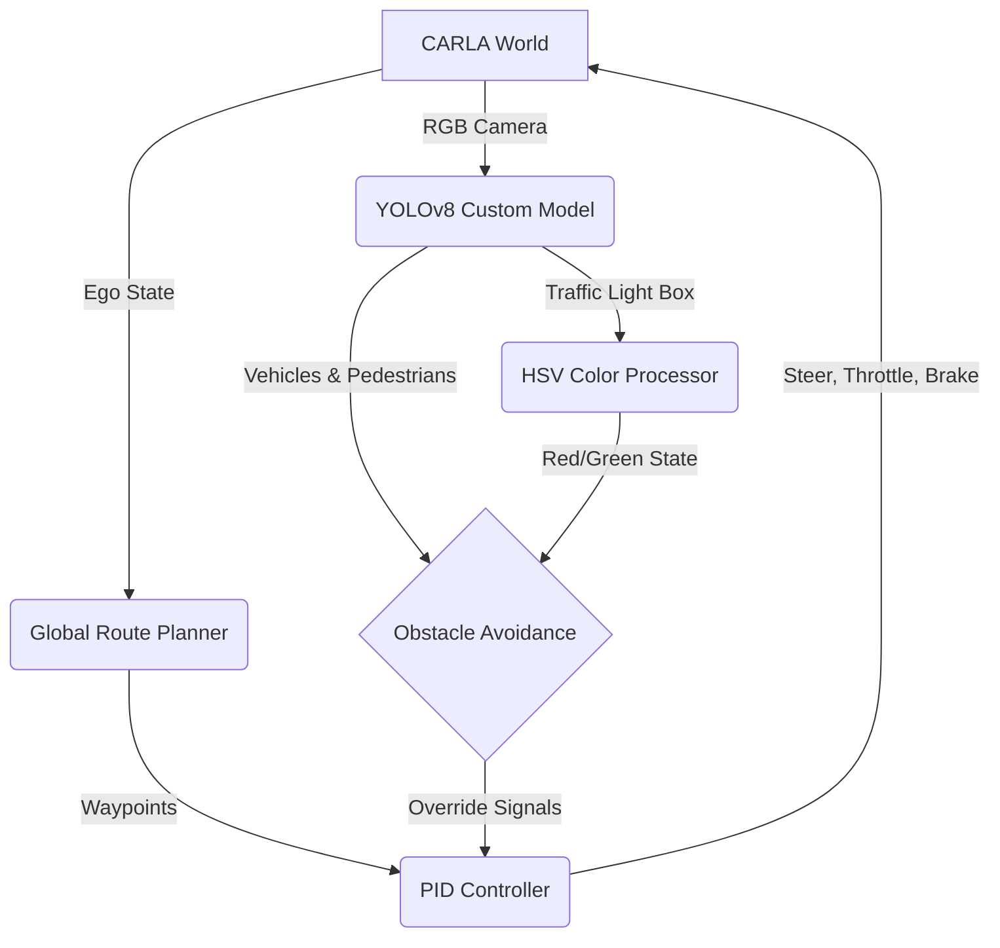

<div align="center">
  <h1 align="center">🚗 Self-Driving Car AI using CARLA & YOLOv8 🧠</h1>
  <p align="center">
    <strong>A Hybrid Autonomous Driving System combining Geometric Control (PID) with Custom Deep Learning Perception.</strong>
  </p>

  <p align="center">
    
    
    
    
  </p>
</div>

<hr>

## 📖 Overview

This repository contains a fully autonomous driving system built on the **CARLA Simulator (v0.9.16)**. It utilizes a powerful **Hybrid Architecture** that bridges mathematically flawless geometric steering with advanced deep-learning-based visual perception.

Instead of relying on fragile "end-to-end" behavioral cloning, this system splits the driving task:
1. **Perception (Vision):** A custom YOLOv8 model trained on 8,600+ CARLA images detects vehicles, pedestrians, and traffic lights in real-time.
2. **Control (Geometric):** CARLA's `BasicAgent` computes precise steering, throttle, and braking using a highly tuned PID controller based on the visual inputs.

<br>

## ✨ Key Features

- **🎯 Custom Vision Model:** A YOLOv8s model fine-tuned specifically for CARLA environments, detecting dynamic obstacles with high precision.
- **🚦 Smart Traffic Light Detection:** Combines YOLO bounding boxes with an HSV brightness thresholding algorithm to accurately determine Red/Yellow/Green states.
- **🗺️ Interactive Map Routing:** Pygame-based 2D map interface allowing users to dynamically select Start and End waypoints for the vehicle.
- **📷 Dual-Camera PiP Interface:** A Third-Person Perspective (TPP) driving view featuring a Picture-in-Picture (PiP) First-Person Perspective (FPP) debug HUD.
- **🛑 Dynamic Emergency Braking:** Calculates semantic bounding box areas to estimate spatial depth, triggering emergency braking only when obstacles are actively in the vehicle's path.

<br>

## 🛠️ Architecture Flow



<br>

## 💻 Requirements & Installation

### 1. CARLA Simulator (0.9.16)
You must have CARLA 0.9.16 installed.
* [Download CARLA 0.9.16 for Linux](https://github.com/carla-simulator/carla/releases/tag/0.9.15) *(Note: 0.9.15/0.9.16 versions are compatible depending on your UE4 build)*.

### 2. Python Dependencies
We recommend using an Anaconda environment (`python=3.10`):
```bash
conda create -n carla_env python=3.10
conda activate carla_env
pip install carla==0.9.15 pygame opencv-python ultralytics numpy torch torchvision
```

<br>

## 🚀 How to Run

1. **Start the CARLA Server:**
   ```bash
   cd /path/to/CARLA_0.9.16
   ./CarlaUE4.sh -quality-level=Epic -opengl
   ```

2. **Launch the Autonomous Driver:**
   There are several inference scripts available in the `Town05_Experiment/` directory depending on your HUD preference:
   
   ```bash
   # Ultimate Version (Features Interactive 2D Map Selection & Dual Cameras)
   python Town05_Experiment/omni_inference_final.py

   # Standard Dual-Camera Version
   python Town05_Experiment/omni_inference_2.py
   
   # Pure FPP YOLO Debug Version
   python Town05_Experiment/omni_inference.py
   ```

<br>

## 📁 Repository Structure
* **`Town05_Experiment/`**: The core active directory.
  * `omni_inference_*.py`: Autonomous inference loops (driving scripts).
  * `train_custom_yolo.py`: Scripts used to train the YOLOv8s model.
  * `omni_data_collector.py`: Automated scripts to spawn NPCs and collect labeled images for the dataset.
* **`yolov8s.pt`**: Base YOLO weights.
* *(Note: The custom `best.pt` model trained on 8600 images is large and should be placed in `AI_STORAGE/yolo_training_results/carla_yolov8s/weights/` if downloaded separately).*

<br>

<div align="center">
  <i>Built with ❤️ by Conqueror</i>
</div>
